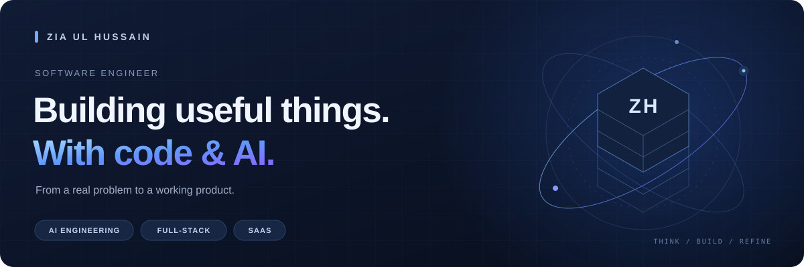

  

  <strong>AI engineering &nbsp; / &nbsp; Full-stack development &nbsp; / &nbsp; SaaS</strong>

  I turn product ideas into working software with .NET, Angular, and AI. 
  I care about understanding the problem, building with purpose, and checking what ships.

---

### What I work with

| AI & agent workflows | Full-stack engineering | Shipping software |
| :--- | :--- | :--- |
| Claude · Cursor · MCP | C# · .NET · ASP.NET Zero | Git · Azure DevOps |
| Custom agents & reusable skills | Angular · TypeScript · ABP | CI/CD · API testing |
| AI-assisted development & validation | Entity Framework · SQL | Code reviews · Automation |

### What I build

**01 / Products that solve real problems**  
SaaS applications, business workflows, and tools that turn everyday friction into useful software.

**02 / AI-assisted engineering workflows**  
Agents, reusable skills, and MCP integrations that support planning, implementation, and review.

**03 / Connected full-stack experiences**  
Clear Angular interfaces backed by .NET services, with attention to the details on both sides.

### On my workbench

- Exploring how agents can coordinate tasks across projects and devices.
- Designing a workspace for planning content across social and developer profiles.
- Improving AI-assisted workflows through better context, validation, and token efficiency.

---

  Understand the problem. Build thoughtfully. Validate the result.

